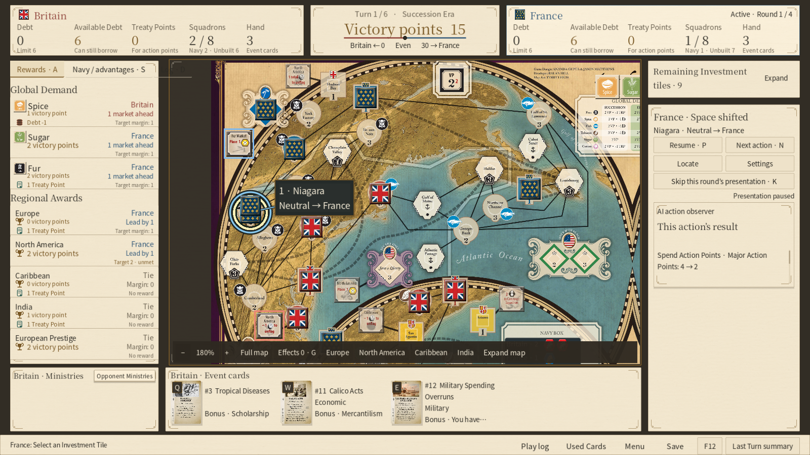
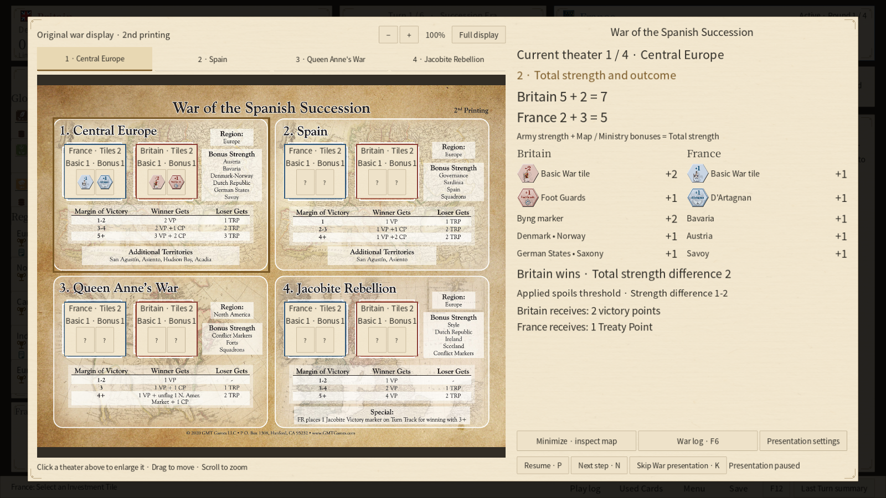
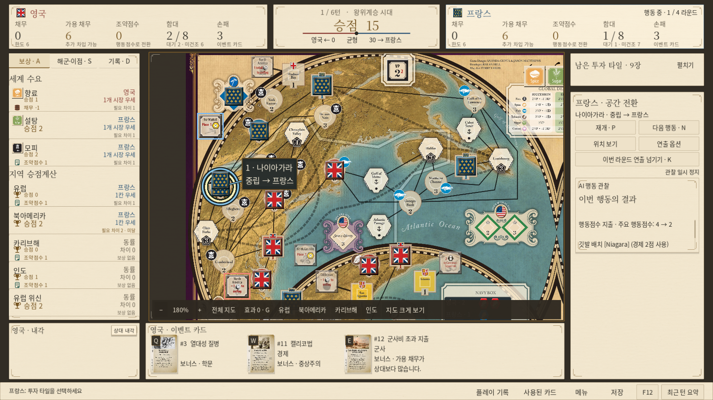
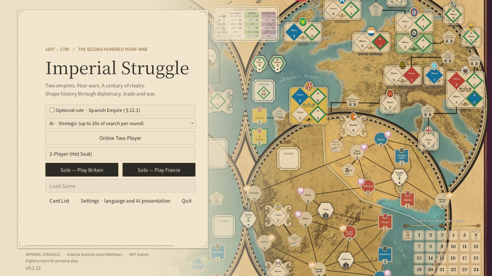
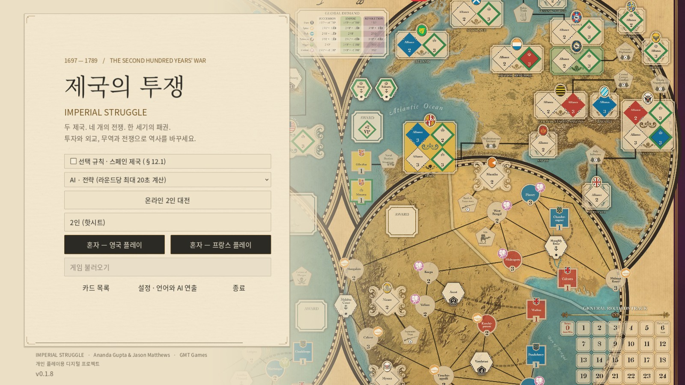
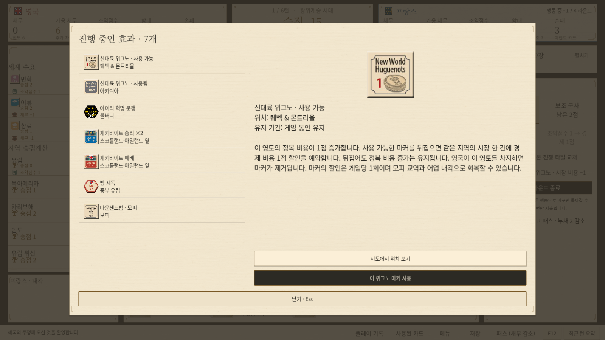

# Imperial Struggle / 제국의 투쟁

An unofficial Windows adaptation of GMT Games' Imperial Struggle, with English and Korean interfaces, solo AI, local two-player play and host-based online play.

GMT Games의 보드게임 제국의 투쟁을 Windows에서 플레이할 수 있도록 만든 비공식 프로젝트입니다. 영어·한국어, AI 대전, 한 컴퓨터 2인 대전, 온라인 2인 대전을 지원합니다.

[Download the latest game / 최신 게임 다운로드](https://github.com/oga8867/imperial-struggle-releases/releases/latest) · [English introduction](#english) · [한국어 소개](#korean) · [Online guide / 온라인 안내](ONLINE_GUIDE.md) · [Keyboard controls / 단축키](KEYBOARD_CONTROLS.md)

Current public build: v0.1.8, Windows x64 test build. 현재 공개 배포: v0.1.8, Windows 64비트 테스트 버전.

## Downloads / 다운로드

Open the release page and expand Assets. Download one of the two game packages below. Both contain the game runtime; Godot, Steam and separate Korean fonts are not required.

릴리스 페이지의 Assets에서 아래 두 파일 중 하나를 받으세요. 게임 실행에 필요한 엔진과 글꼴을 포함하므로 Godot·Steam·별도 한글 글꼴 설치가 필요 없습니다.

| Package / 파일 | Use / 용도 |
| --- | --- |
| [ImperialStruggle-0.1.8-Windows-x64-Setup.exe](https://github.com/oga8867/imperial-struggle-releases/releases/download/v0.1.8/ImperialStruggle-0.1.8-Windows-x64-Setup.exe) | Install and launch from the Start menu / 설치한 뒤 시작 메뉴에서 실행 |
| [ImperialStruggle-0.1.8-Windows-x64-Portable.zip](https://github.com/oga8867/imperial-struggle-releases/releases/download/v0.1.8/ImperialStruggle-0.1.8-Windows-x64-Portable.zip) | Extract the whole folder and run ImperialStruggle.exe / 전체 압축을 풀고 ImperialStruggle.exe 실행 |

Each version has only these two download assets. SHA-256 checksums are listed in the release description; build and verification records are retained locally. For connection instructions, see the [online guide](ONLINE_GUIDE.md).

버전별 다운로드 첨부는 위 두 종류만 제공합니다. SHA-256은 릴리스 설명에서 확인하고 제작·검증 기록은 로컬에 보관합니다. 접속 방법은 [온라인 안내](ONLINE_GUIDE.md)를 확인하세요.

The GitHub-generated “Source code (zip/tar.gz)” files contain this repository's documentation, not the playable game. GitHub가 자동으로 제공하는 “Source code” ZIP/TAR에는 안내 자료가 들어 있습니다. 게임은 Setup.exe 또는 Portable.zip을 받으세요.

## English

### What kind of game is this?

Lead Britain or France through their eighteenth-century rivalry across Europe, North America, the Caribbean and India. Investment Tiles provide opportunities to build markets, secure political alliances and prepare for war. Event Cards and Ministries change what those opportunities are worth. An important space can contribute to commodity scoring, an Advantage and the next war at the same time.

This adaptation manages the rules state, legal choices, scoring, hidden information and turn sequence, while letting players inspect the board and card effects before making decisions. It is an actively developed test build. Its interface explanations help with play; the [official GMT Living Rules](https://gmtwebsiteassets.s3-us-west-2.amazonaws.com/impstruggle/ImpStr_Living_Rules_7-26-20.pdf) remain the rules reference.

### Ways to play

| Mode | How it works |
| --- | --- |
| Solo as Britain or France | Choose Basic or Strategic AI. Strategic AI offers 10, 20 or 30 seconds of thinking time per Action Round; the default is 20 seconds. |
| Local two-player | Both players use one computer, with a handoff screen for private information. |
| Online two-player | The room creator's PC hosts the match. Connect by IP/port or an invitation code. The host must keep the game running. |

The optional Spanish Empire rule (§12.1) can be selected before a new game and is off by default. It adds the specified Spanish neutral Market flags and the opponent's Spanish Political-space choice after eligible conquests.

### Install and start

1. Choose Setup.exe or Portable.zip above. For the ZIP, extract everything rather than running the EXE inside the archive. Keep the PCK and accompanying files with the executable.
2. Launch the game, select English or Korean in settings and choose a play mode.
3. Read the dealt Event Cards before choosing Ministries. A card's detail view shows its full effects and bonus conditions.
4. In online play, have both players check the version at the bottom of the main menu. Use the same release.

The build targets 64-bit Windows 10/11 with OpenGL 3.3 graphics. The bundled Noto Sans/Serif CJK KR fonts cover Korean and Latin text. The default window is 1600 × 900.

### Read the board at a glance

Gameplay capture from v0.1.7; these interface features are also included in v0.1.8.

| Area | Information and controls |
| --- | --- |
| Top dashboard | Both sides' Debt, available borrowing, Treaty Points, total Squadrons and hand size; the central VP track and current Turn/Action Round. Squadron totals distinguish the Navy Box from unbuilt supply. |
| Main map | Drag to pan and scroll to zoom. Zoom out to 75%, restore 100% with the backtick key, or expand the map with F9. Region buttons and F1–F4 move to the four regions. |
| Rewards | Global Demand commodities, Regional Awards and European Prestige. Each row shows the leading side, its margin and whether the required margin is met. Click for the detailed comparison. |
| Navy / Advantages | Navy Box squadrons, owned Advantages, each side's recent Action Round usage out of two, and full effect/availability explanations. Map Advantage tokens open the same detail view. |
| Bottom cards | Your Ministries, their keywords and your Event Cards. Inspect full effects, choose eligible reveals/abilities, or view revealed opponent Ministries with F11. |
| Right action panel | Remaining Investment Tiles, separate Major/Minor/Event action-point pools, legal actions and the AI observer. |

Space tooltips explain the printed cost, the current action's actual cost and the reasons for discounts or increases. Board tokens identify ongoing effects; G opens a list with their locations, durations and effects.

### Cards, Advantages and choices

- Investment Tile keys 1–9 and Event Card keys QWERT open details first. Enter confirms an available choice or use; inspecting a card does not play it.
- Card-retention, discard and Ministry-selection screens offer full effect inspection while preserving your selections. Minimize supported choices to inspect the board; newly dealt Investment Tiles are visible during Event retention.
- Ministries remain private until legally revealed. You can choose whether to reveal for an eligible effect, or reveal during your own Action Round. Opponent inspection shows revealed faces and unrevealed backs/counts.
- Advantage details explain why use is unavailable, including acquisition this Action Round, an exhausted effect, the usage limit, conflicts or missing connections. Use at most two per Action Round and one per Region; resolve one and then use another if it remains legal.
- Unused discount Advantages can offer a return to the point before activation when the undo rules permit it. Undo can restore an earlier eligible Major Action together with subsequent Minor Actions; newly learned cards/tiles and Ministry reveals form information barriers. Online undo needs opponent consent.
- Map and War choices distinguish selecting a candidate from confirming it. Required decisions remain pending while you inspect a card, map or log.

### Peace Turns and Wars

The game has six Peace Turns and four intervening Wars. The first War occurs after Peace Turn 1. The complete sequence is shown [below](#turn-sequence).

During Peace Turns, select Investments and use available Events, action points, Advantages and military preparations. The UI keeps Major, Minor and restricted Event point pools separate. End-of-turn reports show actual scoring and state changes before advancing.

War preparation and resolution use the original War Displays. Inspect your own tile faces, the opponent's tile counts, eligible map bonuses and each Theater's rewards. Bonus tile placement, basic tile replacement and eligible enemy tile removal let you inspect the Theater and map before confirming. Unrevealed opponent tile identities stay hidden.

Each Theater is resolved in order. The presentation shows revealed tiles, strength contributions, totals, the victory margin and the applicable spoils. Required removals or conquests explain whether their source is a tile effect or a Theater reward, and require confirmation. F6 remains available to read public wartime actions. A War's result report appears before the next Peace Turn's Event draw and retention.

War presentation capture from an earlier development build; the latest build includes this strength/outcome view.

### AI: thinking and watching are separate settings

Basic AI ranks legal candidates using its evaluation. Strategic AI tests candidate sequences in isolated simulations using the game's rules, considers the current Action Round and a short opponent response, and samples possible hidden information. It receives its own private information and public information, rather than the opponent's actual hidden cards or tile identities.

Its evaluation considers scoring margins, useful markets and access, Advantage completion/denial, discounts, borrowing and war preparation. Ministry selection uses card preferences, your hand's bonus keywords and, for Strategic AI, combinations plus some current passive value. Ministry selection is separate from the 10–30 second Action Round search.

The AI observer is on by default with a 3-second delay per action. Set 1–5 seconds or turn it off. It shows the selected Investment, used public cards, affected spaces and before/after changes in the right sidebar. Automatic map movement can also be disabled. P pauses/resumes, N shows the next action and K skips the current Action Round's presentation delay. Skipping the presentation still executes the game actions.

War presentation has its own on/off and 1–5 second settings, with a 3-second default and the same pause/next/skip controls. Online players use their own presentation settings and can review independently; required game decisions still belong to the appropriate player.

Current AI limitations: its weights are heuristic, Ministry planning does not model every ability's long-term value, and war preparation does not fully price every Theater's exact reward threshold or special effect. Cutting an opponent's only market-access route is also not comprehensively valued. More thinking time explores the existing evaluation more deeply; it does not remove those limitations. Optimal play, expert-level strength and the current version's win rate have not been established.

### Save, load and follow the match

Ctrl+S opens the Save/Load archive. Create as many named saves as needed, inspect their date, version, mode, Turn/phase, acting side and VP, rename them, overwrite with confirmation or load a selected game. F5 quick-saves to the most recently used slot; before a slot is chosen, it uses the separate quick-save entry. Online match saves and reconnect data are handled separately, with the full match stored by the host.

F6 opens the large play log. Turn and Action Round separators make it easier to follow Events, Advantages, payments, board changes and War results. Click a recorded place to locate and highlight it on the map. Public actions/results and your own private information are recorded; the opponent's hidden hand and unrevealed Ministries are not disclosed.

The log's folder button opens dated, per-match TXT/JSONL records. For a reproducible problem, record the version, mode, side, timestamp, Turn/Action Round, exact message and a screenshot. Inspect logs before sharing them: your own private game information may be present.

### Play with a friend online

Both players use the same release. The host creates a room on UDP 38567 and first tries automatic port mapping (UPnP). The invitation code carries an IP address and port; it is not a relay or a short-code matchmaking service. For different homes, use the host's public IPv4 address.

If automatic mapping fails, forward UDP 38567 to the host PC's local IPv4 address and allow the game's connection in Windows Firewall. Router and provider NAT can affect connectivity. Connection loss pauses play; reconnect with the saved connection profile, or have the host reopen the saved online match. Follow the [step-by-step online guide](ONLINE_GUIDE.md) for setup, reconnect restrictions and troubleshooting.

## 한국어

### 어떤 게임인가요?

영국이나 프랑스를 맡아 유럽·북아메리카·카리브해·인도에서18세기의 패권 경쟁을 벌이는 전략 보드게임입니다. 투자 타일로 시장을 확보하고 정치 동맹을 맺으며 전쟁을 준비합니다. 이벤트와 내각의 조합에 따라 같은 투자도 가치가 달라집니다. 한 칸이 세계 수요 득점, 이점 연결, 다음 전쟁 전력에 동시에 기여할 수 있어 현재 보상과 이후 전쟁을 함께 살펴야 합니다.

이 구현은 합법적인 선택·비용·득점·비공개 정보·턴 진행을 관리하고, 선택 전에 지도와 카드 효과를 확인하도록 돕습니다. 현재는 계속 개선하는 테스트 버전입니다. 게임 안의 설명은 플레이를 돕는 안내이며 규칙의 근거는 [GMT 공식 Living Rules](https://gmtwebsiteassets.s3-us-west-2.amazonaws.com/impstruggle/ImpStr_Living_Rules_7-26-20.pdf)입니다.

### 플레이 방식과 시작 설정

| 방식 | 설명 |
| --- | --- |
| 혼자 영국/프랑스 | 기본 AI 또는 전략 AI와 대전합니다. 전략 AI는 행동 라운드당10·20·30초 계산 예산을 고르며 기본값은20초입니다. |
| 한 컴퓨터 2인 | 두 사람이 같은 PC를 사용합니다. 차례 인계 화면으로 비공개 정보를 가립니다. |
| 온라인 2인 | 방장 PC가 게임 서버가 됩니다. IP/포트나 초대 코드로 접속하며 대국 중 방장 PC와 게임을 계속 켜 둡니다. |

새 판을 만들 때 §12.1 스페인 제국 선택 규칙을 켤 수 있습니다. 기본값은 꺼짐입니다. 켜면 지정된 스페인 시장에 중립 깃발을 놓고, 해당 스페인 영토 정복 후 상대의 스페인 정치 칸 전환 선택을 처리합니다.

### 설치하고 첫 판 시작하기

1. 위 다운로드 표에서 Setup.exe 또는 Portable.zip을 받습니다. ZIP은 압축 안에서 실행하지 말고 전체를 풀어 주세요. EXE 옆의 PCK와 동봉 파일을 함께 둡니다.
2. 게임을 실행하고 설정에서 한국어/영어를 고른 뒤 플레이 방식을 선택합니다.
3. 받은 이벤트 카드의 전체 효과와 보너스 조건을 읽고 내각을 선택합니다. 내각을 선택하기 전에 자기 손패를 확인할 수 있습니다.
4. 온라인 상대에게 같은 릴리스 링크를 보내고 두 사람의 메인 메뉴 하단 버전을 확인합니다.

Windows10/11 64비트와 OpenGL3.3 그래픽을 기준으로 제작했습니다. 기본 창 크기는1600×900이며 한글·라틴 문자를 지원하는 Noto Sans/Serif CJK KR을 동봉합니다. 엔진과 글꼴을 따로 설치할 필요가 없습니다.

### 화면에서 무엇을 확인하나요?

0.1.7의 실제 게임 화면입니다. 이 배치와 기능은 최신0.1.8에도 포함됩니다.

| 위치 | 확인할 정보와 조작 |
| --- | --- |
| 상단 | 양측 채무·추가 차입 가능량·조약점수·함대 총수·손패 수, 가운데 승점 트랙과 현재 턴/라운드. 함대는 해군 상자 대기와 미건조 공급을 구분합니다. |
| 중앙 지도 | 드래그로 이동하고 휠로 확대/축소합니다.75%까지 축소하며 백틱 키로100% 초기화, F9로 크게 보기, F1–F4로 지역 이동을 합니다. |
| 보상 탭 | 세계 수요 자원·지역 승점계산·유럽 위신을 확인합니다. 각 줄 오른쪽에 우세 진영, 차이, 필요한 차이 충족 여부가 보이며 클릭하면 상세 비교를 읽습니다. |
| 해군·이점 탭 | 대기 함대, 보유 이점, 양측 최근 행동 라운드 사용횟수/2를 봅니다. 지도 이점 토큰을 눌러도 같은 효과·사용 조건 창이 열립니다. |
| 하단 카드 | 자기 내각 이름·키워드와 이벤트 손패를 봅니다. 전체 효과 보기·합법적인 공개/능력 사용, F11 상대 내각 확인을 제공합니다. |
| 오른쪽 행동 패널 | 남은 투자 타일, 주요·보조·이벤트 행동점수, 현재 가능한 행동, AI 관찰을 표시합니다. |

지역에 마우스를 올리면 인쇄된 기본 비용과 현재 행동의 실제 비용, 할인·추가 비용의 이유를 읽을 수 있습니다. 위그노·재커바이트 같은 지속 효과는 지도 토큰으로 표시하며 G를 누르면 효과·위치·유지 기간을 목록에서도 확인합니다.

### 카드·이점·선택 화면

- 숫자1–9는 투자 타일, QWERT는 손패 이벤트의 상세를 엽니다. 사용할 수 있는 선택은 Enter로 확정합니다. 상세를 읽는 것만으로 카드를 사용하지 않습니다.
- 남길 카드·버릴 카드·내각 선택에서도 전체 효과를 볼 수 있고 선택 상태가 유지됩니다. 최소화가 제공되는 창은 지도를 확인한 뒤 돌아옵니다. 남길 이벤트 선택 중 최소화하면 새로 배분된 투자 타일도 확인할 수 있습니다.
- 내각은 합법적으로 공개하기 전까지 비공개입니다. 효과를 사용할 수 있는 기회에 공개 여부를 고르거나 자기 행동 라운드에 미리 공개합니다. 상대 내각은 공개된 앞면과 미공개 뒷면·개수만 보여 줍니다.
- 이점 사용이 막히면 사용 버튼과 설명에서 이번 라운드 획득·소진·사용 한도·분쟁·연결 부족 등 이유를 읽습니다. 행동 라운드당 최대2개·지역당1개이며 이점 하나를 처리한 뒤 조건이 맞으면 다음 이점을 사용합니다.
- 미사용 할인은 허용되는 경우 사용 전으로 되돌릴 수 있습니다. 되돌리기 목록에서 주요행동 전을 고르면 이후 보조행동도 함께 취소합니다. 새 카드/전쟁 타일을 확인하거나 내각을 공개한 이전으로는 돌아갈 수 없으며 온라인에서는 상대 동의가 필요합니다.
- 지도와 전쟁의 대상은 후보를 고른 뒤 확정합니다. 지도·카드·기록을 확인하는 동안 필수 선택은 그대로 남습니다.

### 평화와 전쟁은 어떻게 진행되나요?

총6개의 평화 턴 사이에4번의 전쟁이 있습니다. 첫 전쟁은 평화1턴 직후입니다. 전체 순서는 [아래 표](#turn-sequence)를 참고하세요.

평화에는 투자·이벤트·행동점수·이점·군사 준비를 활용합니다. 주요 외교, 보조 경제처럼 행동 종류를 구분하며 지역·용도 제한이 있는 이벤트 점수도 별도 표시합니다. 턴 종료에는 실제 득점과 변화가 요약되고 확인 후 진행합니다.

전쟁 준비와 해결은 원작 전쟁 표시판을 사용합니다. 자기 타일 앞면·상대 타일 개수·전장 보너스·보상을 확인하고 보너스 배치, 기본 타일 교체, 가능한 상대 타일 제거를 결정합니다. 지도를 살펴본 뒤 확정할 수 있으며 상대 미공개 타일의 정체는 숨깁니다.

전장은 하나씩 해결합니다. 공개된 타일과 지도/내각의 전력 기여, 합계, 승리 차이, 그 차이에 해당하는 보상을 보여 줍니다. 깃발 제거나 정복 선택에는 전쟁 타일 효과인지 전장 보상인지 출처를 설명하고 확정 버튼을 제공합니다. 전쟁 중에도 F6으로 상대의 공개 행동과 제거 결과를 읽습니다. 전쟁 결과 확인은 다음 평화 턴의 카드 드로우·남길 카드 선택보다 먼저 나옵니다.

### AI 설정과 행동 관찰

기본 AI는 가능한 행동을 평가해 고릅니다. 전략 AI는 게임 규칙을 사용하는 독립 시뮬레이션에서 현재 라운드의 행동과 상대의 짧은 응수를 비교합니다. 자기 비공개 정보와 공개 정보로 판단하고 상대의 실제 숨은 패·타일 정체를 읽지 않도록 구성했습니다.

평가에는 득점 차이, 시장과 접근권, 이점 완성/차단, 할인, 차입과 전쟁 준비가 들어갑니다. 내각은 고정 선호와 자기 손패의 보너스 키워드를 고려하며 전략 AI는 카드 조합과 일부 현재 지속 효과 가치도 비교합니다. 내각 선택은10~30초 라운드 탐색과 별개입니다.

행동 관찰은 기본 켜짐·행동당3초입니다. 옵션에서1~5초를 고르거나 끌 수 있습니다. 투자 선택, 공개된 사용 카드, 대상 지역, 깃발·토큰의 변경 전후를 오른쪽에서 보여 줍니다. 지도 자동 이동도 끌 수 있습니다. P는 정지/재개, N은 다음 행동, K는 이번 라운드 연출 넘기기입니다. 넘겨도 실제 행동은 정상 처리합니다.

전쟁 연출도 별도 켜기/끄기·1~5초 설정이며 기본3초입니다. 정지·다음·넘기기를 제공하고 온라인에서도 각자의 설정으로 독립 확인합니다. 실제 필수 선택은 해당 플레이어가 수행합니다.

현재 AI는 경험적인 가중치를 사용합니다. 모든 내각 능력의 장기 가치, 전장별 정확한 보상 기준·특수 효과, 상대의 유일한 시장 접근로를 끊는 가치를 충분히 평가하지 못합니다. 계산 시간을 늘리면 같은 평가를 더 많이 시험할 뿐 이 한계가 자동 해결되지는 않습니다. 최적 플레이·숙련자 수준·현재 버전의 승률을 입증한 상태는 아닙니다.

### 저장·불러오기와 플레이 기록

Ctrl+S는 저장·불러오기 보관함입니다. 이름을 붙여 제한 없이 새 슬롯을 만들고 저장 날짜·버전·방식·턴/단계·행동 진영·승점을 확인합니다. 이름 변경·확인 후 덮어쓰기·선택한 판 불러오기를 제공합니다. F5는 마지막 사용 슬롯에 빠른 저장하며 슬롯을 선택하기 전에는 별도 빠른 저장을 사용합니다. 온라인 전체 판은 방장이 저장하고 재접속 자료는 별도 관리합니다.

F6은 큰 플레이 기록 창입니다. 턴과 라운드 구분 아래 이벤트·이점·지출·지도 변화·전쟁 결과를 읽습니다. 기록의 지명을 누르면 지도에서 크게 강조합니다. 공개 행동/결과와 자기 비공개 정보는 기록하지만 상대의 숨은 패·미공개 내각은 공개하지 않습니다.

기록 창의 폴더 버튼으로 날짜·대국별 TXT/JSONL을 엽니다. 문제를 재현하려면 버전·플레이 방식·진영·발생 시각·턴/라운드·정확한 문구·화면을 함께 남겨 주세요. 자기 비공개 정보가 들어갈 수 있으므로 기록은 내용을 확인하고 공유합니다.

### 다른 집의 친구와 온라인으로 하기

양쪽이 같은 릴리스를 실행합니다. 방장은 UDP38567로 방을 만들고 자동 포트 열기(UPnP)를 먼저 시도합니다. 초대 코드는 주소와 포트를 담는 기능이며 중계 서버나 짧은 방번호 서비스가 아닙니다. 서로 다른 집에서는 방장의 공인 IPv4 주소를 사용합니다.

실패하면 공유기에서 UDP38567을 방장 PC의 내부 IPv4로 전달하고 Windows 방화벽에서도 게임 연결을 허용합니다. 공유기·통신사 NAT에 따라 직접 연결이 어려울 수 있습니다. 끊김은 일시 정지하며 저장한 연결 정보로 재접속하거나 방장이 저장된 온라인 판으로 방을 다시 만듭니다. [온라인 안내](ONLINE_GUIDE.md)에 실제 설정 순서와 재접속 제약·문제 확인 방법을 정리했습니다.

## Turn sequence / 전체 턴 순서

| Order / 순서 | Stage / 단계 |
| --- | --- |
| 1 | Peace Turn 1 / 평화1턴 |
| 2 | War of the Spanish Succession / 전쟁1: 스페인 왕위계승전쟁 |
| 3 | Peace Turn 2 / 평화2턴 |
| 4 | Peace Turn 3 / 평화3턴 |
| 5 | War of the Austrian Succession / 전쟁2: 오스트리아 왕위계승전쟁 |
| 6 | Peace Turn 4 / 평화4턴 |
| 7 | Seven Years' War / 전쟁3: 7년 전쟁 |
| 8 | Peace Turn 5 / 평화5턴 |
| 9 | American War of Independence / 전쟁4: 미국 독립 전쟁 |
| 10 | Peace Turn 6 and final scoring / 평화6턴과 최종 득점 |

The shared VP track starts at 15. French gains move it up; British gains move it down. Victory is checked at the rule-defined stages. 승점 트랙은 15에서 시작해 프랑스가 득점하면 올라가고 영국이 득점하면 내려갑니다. 승리 여부는 규칙에서 정한 시점에 확인합니다.

## Useful keys / 자주 쓰는 키

| Keys / 키 | Action / 동작 |
| --- | --- |
| 1–9 / QWERT / Enter | Investment details / Event details / confirm · 투자 상세 / 이벤트 상세 / 확정 |
| Backtick / F1–F4 / F9 | Reset map / regions / expand map · 지도100% 초기화 / 지역 / 크게 보기 |
| A / S / D | Rewards / Navy and Advantages / log tab · 보상 / 해군·이점 / 기록 탭 |
| Z / X / C | Major / Minor / next Event point pool · 주요 / 보조 / 다음 이벤트 점수 |
| Ctrl+S / F5 | Save/Load archive / quick save · 저장 보관함 / 빠른 저장 |
| F6 / F7 / F8 / F11 | Full log / used cards / own War tiles / opponent Ministries · 큰 기록 / 사용된 카드 / 자기 전쟁 타일 / 상대 내각 |
| G / F10 / F12 | Active effects / menu / keyboard guide · 진행 중인 효과 / 메뉴 / 단축키 안내 |
| P / N / K | Pause / next / skip presentation · 연출 정지 / 다음 / 넘기기 |
| Ctrl+Z | Eligible undo; online consent · 가능한 되돌리기, 온라인 상대 동의 |

[Full keyboard guide / 전체 단축키와 선택 창 조작](KEYBOARD_CONTROLS.md)

## More screens / 다른 화면

Main menus / 메인 메뉴 · v0.1.8

Active effects and tokens / 진행 중인 효과와 토큰

This is an earlier development capture of the effects list included in the latest build. 최신 배포에도 포함된 효과 목록의 이전 개발 화면입니다.

## Versions and verification / 버전과 검증 범위

v0.1.8 is the current downloadable build and adds the main-menu version label. It includes the preceding gameplay, online, save, AI-observation and War-presentation work described above. The latest package's recorded checks cover Korean/English startup and extracted-package consistency. This documentation update does not change the game binaries or version.

0.1.8은 현재 다운로드 가능한 버전이며 메인 메뉴 버전 표시를 추가했습니다. 앞서 개발한 게임 진행·온라인·저장·AI 관찰·전쟁 연출을 포함합니다. 해당 배포 기록은 한영 시작과 압축 해제 파일 일치 검사를 다룹니다. 이번 설명 보완은 게임 파일이나 버전을 바꾸지 않습니다.

The release's validation document distinguishes current package checks from earlier gameplay checks. A new test of two different home networks, an exhaustive test of every rule combination, a new installation/uninstallation test and a current AI win-rate study are not claimed for v0.1.8.

릴리스의 검증 문서에서 이번 배포 검사와 이전 게임 검사 범위를 구분합니다.0.1.8에서 서로 다른 집의 실제 접속, 모든 규칙 조합, 설치/제거, 현재 AI 승률을 새로 검증했다고 주장하지 않습니다.

Original v0.1.0, v0.1.1 and v0.1.2 release packages are preserved in [All releases](https://github.com/oga8867/imperial-struggle-releases/releases). Those older packages lack later features; use the latest release for online testing. Intermediate local builds were not all published.

원래0.1.0·0.1.1·0.1.2 배포 파일은 [이전 릴리스](https://github.com/oga8867/imperial-struggle-releases/releases)에 보존했습니다. 이전 파일에는 이후 기능이 없으므로 온라인 테스트에는 최신판을 사용하세요. 모든 중간 개발 버전을 공개 배포한 것은 아닙니다.

## Repository and credits / 저장소와 출처

This public repository contains player documentation, selected screenshots and release downloads. Game source and development Git history are maintained in a separate private repository. Cloning this repository downloads the guides and images; obtain the playable package through Releases.

이 공개 저장소에는 플레이 안내·선별 화면·배포 파일을 둡니다. 게임 소스와 개발 Git 이력은 별도 비공개 저장소에서 관리합니다. 저장소를 복제하면 안내와 그림을 받으므로 실행할 게임은 Releases에서 다운로드하세요.

Imperial Struggle was designed by Ananda Gupta and Jason Matthews and published by GMT Games. This is an unofficial personal project and does not claim endorsement. Original artwork and third-party materials remain with their respective rights holders. Godot and the bundled Noto fonts retain their own license notices. See [Notices / 출처 및 이용 조건](NOTICE.md) and the package's licenses folder.

원작 설계는 Ananda Gupta·Jason Matthews, 출판은 GMT Games입니다. 이 프로젝트는 비공식 개인 구현이며 원작자·출판사의 보증을 주장하지 않습니다. 원작 그림과 제3자 자료의 권리는 각 권리자에게 있고 Godot·Noto 글꼴의 이용 조건은 배포에 동봉합니다. 자세한 내용은 [출처 및 이용 조건](NOTICE.md)을 참고하세요.
